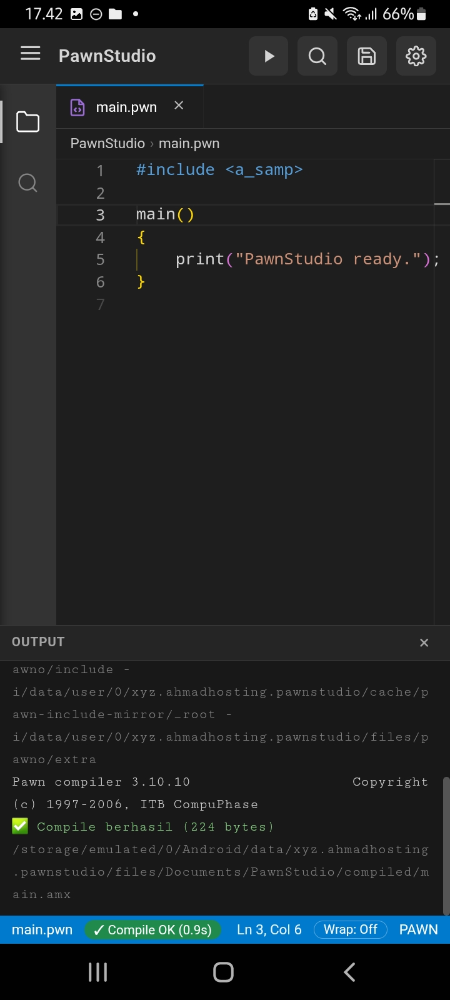
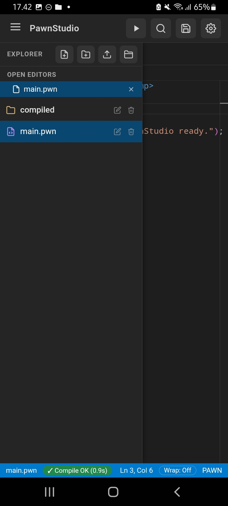

# PawnStudio

Mobile code editor untuk bahasa **PAWN**, dibangun khusus buat komunitas SA-MP / open.mp yang mau ngoding langsung dari Android, gak perlu buka laptop.

Dibangun pakai HTML, CSS, dan JavaScript murni, dibungkus jadi APK Android lewat [Capacitor](https://capacitorjs.com/).

## 📱 Tampilan

<p>
  
  
</p>

## ✨ Fitur

- **Monaco Editor**: engine editor yang sama kayak dipakai VS Code
- **Syntax highlighting PAWN**: keyword, string, comment, angka, dan function call punya warna sendiri
- **File Explorer**: bikin, buka, dan hapus file/folder langsung dari sidebar
- **Icon folder & file berwarna**: gamemodes, plugins, scriptfiles, .pwn, .inc, .dll, dan lainnya mudah dikenali sekilas
- **Dukungan Node.js**: auto-complete modul bawaan Node (fs, path, http, dll) dan snippet, buat nulis bot dan script langsung dari HP
- **Jalanin Node.js di HP**: runtime Node.js 18 tertanam di APK (arm64), tekan Run di file .js dan output tampil live
- **Node.js jalan di latar belakang**: bot tetap hidup walau app ditutup atau layar mati (foreground service + tombol Stop di notifikasi)
- **Cek kompatibilitas HP**: Pengaturan, tombol Cek HP, menampilkan fitur yang didukung di HP kamu. Syarat: Android 8.0 ke atas dan HP arm64 (64-bit)
- **npm install di HP**: tombol npm di Explorer, pasang paket JavaScript murni (discord.js, express, dll) langsung ke folder project
- **Multi-tab**: buka beberapa file `.pwn` sekaligus, ada indikator unsaved changes
- **Compile langsung di HP**: pakai `pawncc` native (arm64-v8a), hasilnya tampil di panel output
- **Auto-complete PAWN dari project**: saran `native`, `stock`, `define`, dan `enum` dari isi project
- **Emmet & Format Kode**: ketik `ul>li*3` di HTML/CSS, plus tombol **Fmt** untuk merapikan kode
- **Cari & Ganti di semua file**: kayak Ctrl+Shift+F di VS Code, dengan opsi huruf besar/kecil, kata utuh, regex, dan filter ekstensi
- **Git di dalam aplikasi**: lihat status, cabang, dan riwayat, lalu commit, push, dan pull langsung dari HP (HTTPS + token GitHub)
- **Preview HTML/CSS/JS**: live preview, mode split, gambar lokal, dan `console.log` tampil di panel Output
- **Pilihan versi SA-MP**: `0.3.DL-R1`, `0.3.7-R2-1`, atau `0.3.7-R3`, supaya fungsi khusus DL langsung error saat compile kalau targetnya 0.3.7
- **Pengaturan**: tema editor (Monokai, Dracula, One Dark, AMOLED, Light), ukuran font, dan flag compiler tambahan
- **Python offline** — file `.py` bisa langsung dijalankan di app (Pyodide 3.12), lengkap dengan panel output dan tombol Stop
- **Auto build APK**: tiap push ke `main`, GitHub Actions otomatis build APK dan bikin Release

## 📦 Struktur Proyek

```
PawnStudio/
├── www/                    # Source web app (HTML, CSS, JS, Monaco)
├── android/                # Project Android (hasil Capacitor + plugin native)
├── .github/workflows/      # CI/CD: build APK & build pawncc
├── capacitor.config.json
├── package.json
├── CHANGELOG.md
└── LICENSE.md
```

## 🚀 Development

Proyek ini dikembangkan langsung dari **Termux** di Android, tanpa laptop.

### Jalankan di browser (testing cepat)

Buka `www/index.html` langsung di browser HP, atau host lokal pakai:

```bash
cd www
python -m http.server 8080
```

Catatan: fitur compile cuma jalan di APK, karena `pawncc` adalah binary native Android.

### Sinkronisasi ke Android

```bash
npx cap sync android
```

### Build APK

APK di-build otomatis lewat GitHub Actions tiap kali push ke branch `main`. Hasil build bisa didownload dari:

- Tab **Actions**, pilih run terbaru, bagian **Artifacts**
- Tab **Releases** (dibuat otomatis tiap build sukses)

> Saat ini compiler cuma tersedia untuk **arm64-v8a**. Binary `pawncc` dibuild lewat workflow `build-pawncc-arm64.yml`.

## 🗺️ Roadmap

- [x] Struktur editor dasar
- [x] File management (explorer + multi-tab)
- [x] Syntax highlighting PAWN
- [x] CI/CD build APK otomatis
- [x] Compiler `pawncc` native + panel output
- [x] Preflight sebelum compile (kurung seimbang, karakter nyasar)
- [x] Perbaikan bar simbol
- [x] Folder picker native (SAF)
- [x] Auto-complete / IntelliSense untuk fungsi PAWN umum
- [x] Custom theme & font size settings
- [x] Include proyek otomatis terdeteksi (include/ dan pawno/include)
- [x] Multi-file compile (include ditelusuri otomatis)
- [x] Emmet dan format kode
- [x] Auto-complete PAWN dari isi project
- [x] Git di dalam aplikasi (status, commit, push, pull)
- [x] Preview HTML/CSS/JS
- [x] Cari & Ganti di semua file
- [x] Pilihan versi SA-MP dan flag compiler tambahan

## 🔒 Catatan Keamanan

- Token GitHub (fitur Git) disimpan di penyimpanan privat aplikasi dan tidak ikut backup Android, tapi belum dienkripsi tambahan. Pakai token khusus repo yang dipakai dengan akses seminimal mungkin.
- Fitur Cari & Ganti dan Ganti Semua menulis langsung ke file project dan tidak bisa di-undo. Simpan atau commit dulu sebelum dipakai.

## 👤 Author

**Julakk**: [github.com/Julakk](https://github.com/Julakk)

Bagian dari ekosistem **Ahmad Store** (hosting server game SA-MP/open.mp, FiveM, Minecraft, VPS).

## 📄 License

Dirilis sebagai freeware (bukan open source). Lihat [LICENSE.md](LICENSE.md) dan [THIRD_PARTY_NOTICES.md](THIRD_PARTY_NOTICES.md).

## Pihak ketiga

- Include open.mp yang dibundel (`assets/pawno/omp`) berasal dari [openmultiplayer/omp-stdlib](https://github.com/openmultiplayer/omp-stdlib), lisensi MPL-2.0, tanpa modifikasi.
